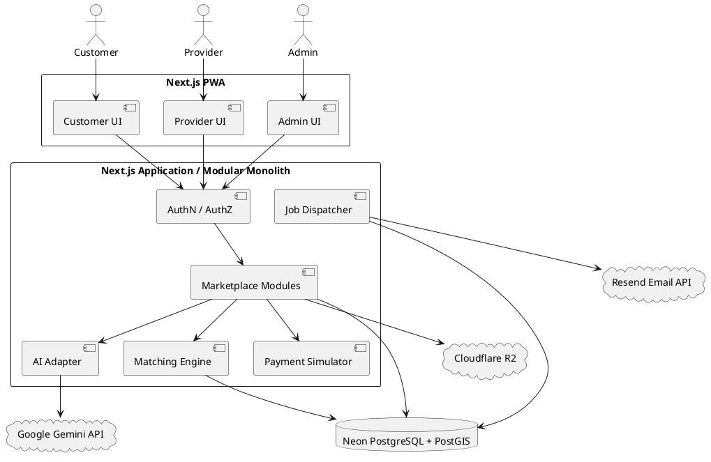

# SPEC-001 — AI-Powered Service Marketplace

## 1. Background

The goal is to build an AI-powered, two-sided services marketplace, initially launching in Agra, Uttar Pradesh, India, with the ability to expand nationwide.

The platform connects customers who need services with verified providers who can perform them. Customers describe needs in natural language, receive AI-assisted task structuring, discover suitable providers, compare offers, and manage the task through completion.

Providers can apply to join the marketplace, undergo manual verification, specify skills and availability, receive relevant opportunities, submit offers, and manage accepted work.

The platform supports digital and physical services, including appointment-based work, while protecting user privacy and enforcing appropriate provider qualifications.

## 2. Architectural approach

- **Application:** Next.js (App Router) with JavaScript/JSX and Tailwind CSS v4.
- **Database:** PostgreSQL on Neon, accessed through Drizzle ORM.
- **Deployment:** Vercel initially, subject to commercial-plan restrictions before launch.
- **File storage:** Cloudflare R2 with private access.
- **AI:** Google Gemini behind a provider-independent interface.
- **Authentication:** Custom email/password sessions with mandatory TOTP MFA for administrators.
- **Communications:** Resend for email and PostgreSQL-backed messaging and notifications.
- **Payments:** A simulator and provider-neutral architecture; real payment integration comes later.

The MVP prioritizes a secure, functional marketplace over premature microservices or expensive infrastructure.

## 3. Requirements (MoSCoW)

### Must have
- Customer registration and account management.
- Provider applications, manual verification, and skill management.
- AI-assisted task creation with customer approval before publication.
- Deterministic eligibility filtering, provider ranking, offers, and provider selection.
- Geographic matching using PostgreSQL (PostGIS geometry or numeric coordinates with haversine), subject to ADR-113 and deployment verification.
- Scheduling, availability, and booking conflict prevention.
- Task-specific messaging and private file attachments.
- Task completion confirmation using OTP.
- Cancellations, disputes, mutual reviews, and moderation.
- In-app notifications and essential email notifications.
- Administrative dashboard and support workflows.
- Simulated payments, commission calculations, financial ledger, and reconciliation.
- Automated tests, controlled deployment, backups, and operational monitoring.

### Should have
- Category-specific verification requirements and expiration handling.
- Severity-based moderation and audited administrative actions.
- Provider-neutral adapters for AI, email, object storage, and payments.
- Shared rate limiting, idempotency, and durable job processing.
- Independent encrypted database backups and tested restoration.

### Could have
- Audio/video calling.
- Automated provider verification.
- Advanced search infrastructure and vector databases.
- Automated dispute resolution.
- Additional interface languages.

### Won't have in the initial MVP
- Live payments and automated real-money payouts.
- Audio/video calling.
- Automated verification and automated dispute decisions.
- A separate microservice per domain.

## 4. High-level architecture

The application is a modular monolith. Background jobs are triggered reliably through scheduled or other controlled invocations; Vercel serverless execution is not treated as a permanently running worker.

## 5. Module responsibilities

| Module | Responsibility |
|---|---|
| Authentication | Registration, login, password recovery, sessions, MFA integration |
| Users | Profiles, account status, deletion requests, preferences |
| Providers | Applications, verification, skills, service areas, availability |
| Categories | Categories, skills, qualification requirements |
| Tasks | Task creation, publication, lifecycle, cancellation |
| AI Interpretation | Structured task extraction, schema validation, usage limits |
| Matching | Eligibility filters, geographic filtering, provider ranking |
| Offers | Provider quotations, acceptance, agreed-price records |
| Bookings | Availability, appointments, booking conflicts |
| Messaging | Task-specific conversations and attachments |
| Payments | Simulated transactions, commission, refunds, ledger |
| Notifications | In-app notifications and email delivery |
| Reviews | Ratings, written feedback, moderation |
| Disputes | Evidence, administrator decisions, resolution records |
| Administration | Provider approval, support, moderation, audit access |
| Operations | Job processing, reconciliation, health checks, AI usage tracking |

Each module owns its business rules. API handlers validate/authenticate requests and call module services; substantial business logic must not live in route handlers.

## 6. Request processing

1. Validate request body, parameters, and content type.
2. Authenticate the caller.
3. Check authorization, ownership, relationship, and business permissions.
4. Execute the module business operation.
5. Use a transaction for coordinated database changes.
6. Record required audit events and enqueue external side effects.
7. Return a standardized response.

## 7. Background jobs

Use PostgreSQL-backed jobs for email delivery, notifications, verification-expiry reminders, matching batches, AI usage maintenance, and financial reconciliation.

Jobs need type, validated payload, status, attempt count, next execution time, lease expiration, idempotency key, timestamps, and sanitized error details. Workers claim jobs atomically using locking such as `FOR UPDATE SKIP LOCKED`, retry with bounded backoff, and reclaim abandoned jobs after lease expiry.

A job is not the source of truth for financial state. Durable business records must be committed safely before retryable external side effects are processed.

## 8. Technology boundaries

- **Drizzle ORM:** relational data access and versioned migrations.
- **PostgreSQL:** transactions, constraints, durable job state, and geographic queries (PostGIS geometry or numeric coordinates with haversine — decision open, see SPEC-006 ADR-113).
- **Gemini adapter:** AI requests, schema validation, timeouts, and usage records.
- **R2 adapter:** private uploads, authorized downloads, expiring signed URLs.
- **Email adapter:** Resend with retryable delivery and development mock.
- **Payment adapter:** simulator now; production provider later.

## 9. Deferred scope

- Live payments and automated payouts.
- Audio/video calling.
- Automated provider verification.
- Advanced search/vector database.
- Automated dispute resolution.
- Interface localization beyond English in the initial release.

## 10. Key constraints

- Solo development and low initial infrastructure cost.
- Hindi and English task descriptions, English interface at launch.
- Customer approval required before AI-interpreted task publication.
- Backend-enforced authorization, qualifications, financial integrity, and state transitions.
- Controlled Agra pilot before expansion.
- Verify vendor plans, terms, and applicable compliance obligations before commercial launch.
