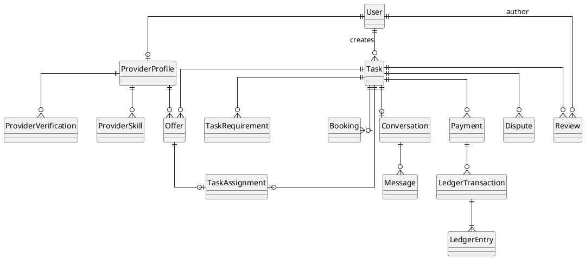

# SPEC-002 — Database Design

## 1. Database principles

- PostgreSQL on Neon, Drizzle ORM. Geographic matching is either PostGIS geometry or numeric coordinates with haversine (open decision, ADR-113).
- UUID primary keys for business entities.
- UTC timestamps stored as `timestamptz`; retain IANA timezone context for local schedules.
- Money stored as integer minor units plus currency code.
- Foreign keys, unique/check constraints, transactions, and versioned migrations.
- Critical financial and state-transition history preserved.
- Soft deletion where appropriate, subject to retention and erasure requirements.
- Files stored in private object storage rather than PostgreSQL.
- Sensitive verification documents and precise addresses remain access-controlled.

## 2. Core entity groups

Schema is split into domain-scoped Drizzle files under `src/lib/db/schema/` to keep changes organized and avoid migration conflicts. Table names are snake_case in PostgreSQL; Drizzle exports are camelCase.

### `users.js` — identity and access
- `users`, `user_sessions`, `admin_profiles`, `admin_mfa_credentials`, `audit_logs`
- `account_deletion_requests`, `verification_tokens`

### `providers.js` — supply and taxonomy
- `provider_profiles`, `service_categories`, `skills`, `provider_skills`, `provider_service_areas`
- `verification_requirements`, `provider_verifications`

Provider qualification rules are category-specific. Self-selected skill level is not proof of competence. `CategorySkill` is intentionally omitted: a skill already belongs to exactly one category via `skills.category_id`.

### `tasks.js` — demand, matching, offers
- `tasks`, `task_requirements`, `task_locations`, `task_attachments`
- `match_runs`, `match_candidates`, `offers`, `task_assignments`

Preserve the original task description separately from AI interpretation. Relational fields remain authoritative for eligibility, scheduling, safety, budget, and authorization; optional JSON is for non-authoritative metadata.

### `bookings.js` — scheduling and completion
- `provider_availability`, `availability_exceptions`, `bookings`, `completion_confirmations`

### `messaging.js` — communication and notifications
- `conversations`, `messages`, `message_attachments`, `notifications`, `email_deliveries`

### `payments.js` — financial records
- `payments`, `refunds`, `payouts`, `ledger_transactions`, `ledger_entries`
- `commission_calculations`, `idempotency_records`, `reconciliation_runs`, `reconciliation_exceptions`

### `reviews.js` — quality and moderation
- `reviews`, `review_reports`, `moderation_cases`

### `disputes.js` — disputes and support
- `disputes`, `dispute_evidence`, `dispute_admin_notes`, `support_tickets`, `support_ticket_messages`

### `jobs.js` — background processing and AI usage
- `background_jobs`, `ai_usage_records`, `platform_settings`

`Account` (OAuth linkage) is not part of the MVP because authentication is custom email/password sessions.

## 3. Conceptual relationships



This is conceptual; final cardinalities and nullable relationships are reflected in the executable Drizzle schema (`src/lib/db/schema/`) and migrations (`drizzle/`).

## 4. Critical integrity rules

1. A verified email maps to at most one user; use normalized email and a database uniqueness constraint.
2. Unapproved or suspended providers cannot accept tasks.
3. A task cannot have multiple simultaneously active assignments.
4. Accepted offer price and terms cannot be silently overwritten.
5. Confirmed bookings cannot overlap for the same provider.
6. Completion OTP can be consumed successfully only once.
7. A participant can submit at most one review per task.
8. Ledger entries are immutable; corrections use compensating entries.
9. Retryable operations use durable idempotency records and unique constraints.
10. Sensitive administrative actions are auditable.
11. Precise address is not exposed before the permitted stage.
12. Foreign-key deletion behavior preserves required financial, dispute, and audit history.

## 5. Booking conflict prevention

Use PostgreSQL range types and an exclusion constraint, or a rigorously tested locking strategy. The reconciled schema uses an expression exclusion constraint:

```sql
CREATE EXTENSION IF NOT EXISTS btree_gist;

ALTER TABLE "bookings"
ADD CONSTRAINT "bookings_no_overlap"
EXCLUDE USING gist (
  "provider_id" WITH =,
  tstzrange("scheduled_start", "scheduled_end") WITH &&
)
WHERE ("status" IN ('confirmed', 'in_progress'));
```

Application checks are not enough to prevent races. The constraint is shipped as reviewed custom SQL alongside the Drizzle migration and must be validated together with Drizzle compatibility and status semantics.

## 6. Financial integrity

- Integer minor units and explicit currency.
- Balanced ledger transactions: total debits equal total credits per currency.
- Append-only ledger entries and compensating entries for corrections.
- Unique idempotency key scoped to operation.
- Reject a reused key with a different request fingerprint.
- Avoid external payment calls inside long-running DB transactions.
- Record commission rate, amount, currency, calculation timestamp, and policy version.
- Reconcile payment/refund/commission/payout records and report discrepancies.

## 7. Task state machine

Canonical primary states (ADR-112):

`draft → published → matching → offers_received → assigned → in_progress → completed`

Additional states: `disputed`, `cancelled`. The earlier `provider_selected` and `completion_submitted` names are retired; provider selection is recorded by the `assigned` state plus the `task_assignments` row, and completion confirmation is recorded by `completion_confirmations.confirmed_at`.

Canonical transitions:

- `draft → published | cancelled`
- `published → matching | cancelled`
- `matching → offers_received | cancelled`
- `offers_received → assigned | cancelled`
- `assigned → in_progress | cancelled`
- `in_progress → completed | disputed`
- `disputed → completed | cancelled`
- `completed`, `cancelled` are terminal

A transition service must validate actor, current state, eligibility, and preconditions, then atomically record state change and audit metadata. Clients cannot set arbitrary state values. Invalid transitions return `INVALID_STATE_TRANSITION` (HTTP 409).

Payment and payout lifecycles are separate from task lifecycle.

## 8. Geographic data (ADR-113, open)

Two implementation options are documented; the choice is deferred pending Neon PostGIS verification:

1. **PostGIS geometry:** `geography(Point, 4326)` columns with GiST indexes, distance in meters via geography operations.
2. **Numeric coordinates:** `numeric(10,7)` latitude/longitude columns (current schema) with application-level haversine distance filtering and no GiST index.

Both options must preserve the following behavior:

- Public profiles expose approximate service areas only.
- Exact customer address is revealed only to the selected provider when required for a confirmed appointment.
- Remote tasks are exempt from distance penalties.
- Distance is computed with a documented meter unit and index usage is verified before relying on it at scale.

Verify PostGIS availability and current Drizzle integration on the selected database plan before implementation.

## 9. Migrations and tests

Use versioned Drizzle migrations (`drizzle/`) and reviewed custom SQL when needed (for example the booking exclusion constraint and positive-value checks). Run production migrations explicitly, not at application startup.

Test:
- Duplicate email prevention.
- Concurrent offer acceptance.
- Overlapping booking attempts.
- Provider approval revocation during acceptance.
- Idempotency duplicate/mismatched payloads.
- Ledger balance and immutable history.
- OTP expiry/single use.
- Unauthorized task transitions.
- PostGIS distance queries and index usage.
- Migration and restore procedures.
