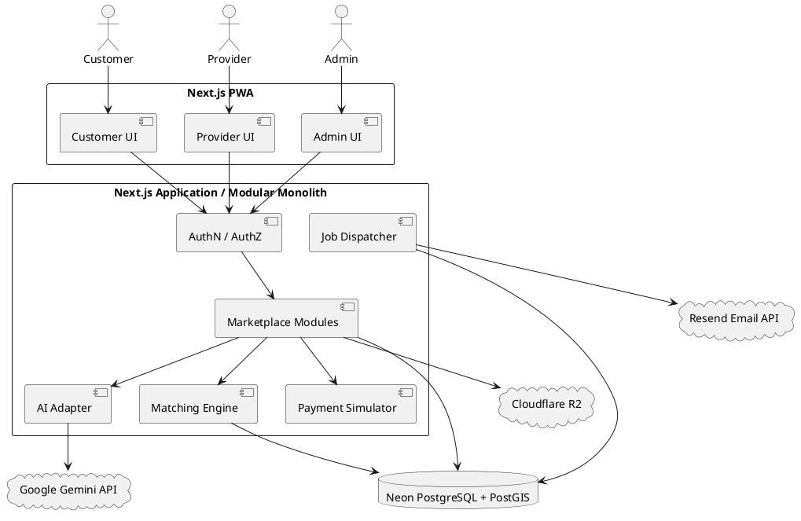
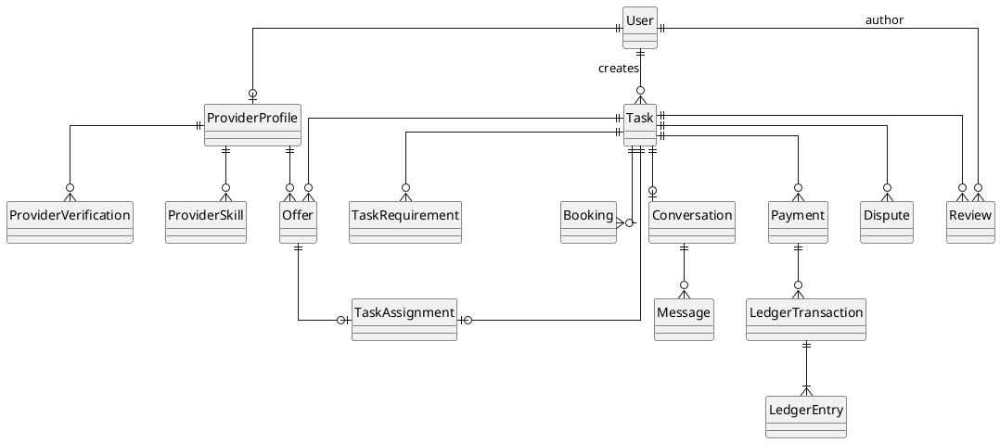

# AI-Powered Service Marketplace — Complete Documentation Package

**Version:** 1.1  
**Status:** Reconciled architecture baseline; JavaScript/JSX + Drizzle, canonical task states, geographic decision open.  
**Generated:** This file is generated from the SPEC documents by `npm run docs:build`. Do not edit it directly.

# SPEC-001 — AI-Powered Service Marketplace

## 1. Background

The goal is to build an AI-powered, two-sided services marketplace, initially launching in Agra, Uttar Pradesh, India, with the ability to expand nationwide.

The platform connects customers who need services with verified providers who can perform them. Customers describe needs in natural language, receive AI-assisted task structuring, discover suitable providers, compare offers, and manage the task through completion.

Providers can apply to join the marketplace, undergo manual verification, specify skills and availability, receive relevant opportunities, submit offers, and manage accepted work.

The platform supports digital and physical services, including appointment-based work, while protecting user privacy and enforcing appropriate provider qualifications.

## 2. Architectural approach

- **Application:** Next.js (App Router) with JavaScript/JSX and Tailwind CSS v4.
- **Database:** PostgreSQL on Neon, accessed through Drizzle ORM.
- **Deployment:** Vercel initially, subject to commercial-plan restrictions before launch.
- **File storage:** Cloudflare R2 with private access.
- **AI:** Google Gemini behind a provider-independent interface.
- **Authentication:** Custom email/password sessions with mandatory TOTP MFA for administrators.
- **Communications:** Resend for email and PostgreSQL-backed messaging and notifications.
- **Payments:** A simulator and provider-neutral architecture; real payment integration comes later.

The MVP prioritizes a secure, functional marketplace over premature microservices or expensive infrastructure.

## 3. Requirements (MoSCoW)

### Must have
- Customer registration and account management.
- Provider applications, manual verification, and skill management.
- AI-assisted task creation with customer approval before publication.
- Deterministic eligibility filtering, provider ranking, offers, and provider selection.
- Geographic matching using PostgreSQL (PostGIS geometry or numeric coordinates with haversine), subject to ADR-113 and deployment verification.
- Scheduling, availability, and booking conflict prevention.
- Task-specific messaging and private file attachments.
- Task completion confirmation using OTP.
- Cancellations, disputes, mutual reviews, and moderation.
- In-app notifications and essential email notifications.
- Administrative dashboard and support workflows.
- Simulated payments, commission calculations, financial ledger, and reconciliation.
- Automated tests, controlled deployment, backups, and operational monitoring.

### Should have
- Category-specific verification requirements and expiration handling.
- Severity-based moderation and audited administrative actions.
- Provider-neutral adapters for AI, email, object storage, and payments.
- Shared rate limiting, idempotency, and durable job processing.
- Independent encrypted database backups and tested restoration.

### Could have
- Audio/video calling.
- Automated provider verification.
- Advanced search infrastructure and vector databases.
- Automated dispute resolution.
- Additional interface languages.

### Won't have in the initial MVP
- Live payments and automated real-money payouts.
- Audio/video calling.
- Automated verification and automated dispute decisions.
- A separate microservice per domain.

## 4. High-level architecture



The application is a modular monolith. Background jobs are triggered reliably through scheduled or other controlled invocations; Vercel serverless execution is not treated as a permanently running worker.

## 5. Module responsibilities

| Module | Responsibility |
|---|---|
| Authentication | Registration, login, password recovery, sessions, MFA integration |
| Users | Profiles, account status, deletion requests, preferences |
| Providers | Applications, verification, skills, service areas, availability |
| Categories | Categories, skills, qualification requirements |
| Tasks | Task creation, publication, lifecycle, cancellation |
| AI Interpretation | Structured task extraction, schema validation, usage limits |
| Matching | Eligibility filters, geographic filtering, provider ranking |
| Offers | Provider quotations, acceptance, agreed-price records |
| Bookings | Availability, appointments, booking conflicts |
| Messaging | Task-specific conversations and attachments |
| Payments | Simulated transactions, commission, refunds, ledger |
| Notifications | In-app notifications and email delivery |
| Reviews | Ratings, written feedback, moderation |
| Disputes | Evidence, administrator decisions, resolution records |
| Administration | Provider approval, support, moderation, audit access |
| Operations | Job processing, reconciliation, health checks, AI usage tracking |

Each module owns its business rules. API handlers validate/authenticate requests and call module services; substantial business logic must not live in route handlers.

## 6. Request processing

1. Validate request body, parameters, and content type.
2. Authenticate the caller.
3. Check authorization, ownership, relationship, and business permissions.
4. Execute the module business operation.
5. Use a transaction for coordinated database changes.
6. Record required audit events and enqueue external side effects.
7. Return a standardized response.

## 7. Background jobs

Use PostgreSQL-backed jobs for email delivery, notifications, verification-expiry reminders, matching batches, AI usage maintenance, and financial reconciliation.

Jobs need type, validated payload, status, attempt count, next execution time, lease expiration, idempotency key, timestamps, and sanitized error details. Workers claim jobs atomically using locking such as `FOR UPDATE SKIP LOCKED`, retry with bounded backoff, and reclaim abandoned jobs after lease expiry.

A job is not the source of truth for financial state. Durable business records must be committed safely before retryable external side effects are processed.

## 8. Technology boundaries

- **Drizzle ORM:** relational data access and versioned migrations.
- **PostgreSQL:** transactions, constraints, durable job state, and geographic queries (PostGIS geometry or numeric coordinates with haversine — decision open, see SPEC-006 ADR-113).
- **Gemini adapter:** AI requests, schema validation, timeouts, and usage records.
- **R2 adapter:** private uploads, authorized downloads, expiring signed URLs.
- **Email adapter:** Resend with retryable delivery and development mock.
- **Payment adapter:** simulator now; production provider later.

## 9. Deferred scope

- Live payments and automated payouts.
- Audio/video calling.
- Automated provider verification.
- Advanced search/vector database.
- Automated dispute resolution.
- Interface localization beyond English in the initial release.

## 10. Key constraints

- Solo development and low initial infrastructure cost.
- Hindi and English task descriptions, English interface at launch.
- Customer approval required before AI-interpreted task publication.
- Backend-enforced authorization, qualifications, financial integrity, and state transitions.
- Controlled Agra pilot before expansion.
- Verify vendor plans, terms, and applicable compliance obligations before commercial launch.

---

# SPEC-002 — Database Design

## 1. Database principles

- PostgreSQL on Neon, Drizzle ORM. Geographic matching is either PostGIS geometry or numeric coordinates with haversine (open decision, ADR-113).
- UUID primary keys for business entities.
- UTC timestamps stored as `timestamptz`; retain IANA timezone context for local schedules.
- Money stored as integer minor units plus currency code.
- Foreign keys, unique/check constraints, transactions, and versioned migrations.
- Critical financial and state-transition history preserved.
- Soft deletion where appropriate, subject to retention and erasure requirements.
- Files stored in private object storage rather than PostgreSQL.
- Sensitive verification documents and precise addresses remain access-controlled.

## 2. Core entity groups

Schema is split into domain-scoped Drizzle files under `src/lib/db/schema/` to keep changes organized and avoid migration conflicts. Table names are snake_case in PostgreSQL; Drizzle exports are camelCase.

### `users.js` — identity and access
- `users`, `user_sessions`, `admin_profiles`, `admin_mfa_credentials`, `audit_logs`
- `account_deletion_requests`, `verification_tokens`

### `providers.js` — supply and taxonomy
- `provider_profiles`, `service_categories`, `skills`, `provider_skills`, `provider_service_areas`
- `verification_requirements`, `provider_verifications`

Provider qualification rules are category-specific. Self-selected skill level is not proof of competence. `CategorySkill` is intentionally omitted: a skill already belongs to exactly one category via `skills.category_id`.

### `tasks.js` — demand, matching, offers
- `tasks`, `task_requirements`, `task_locations`, `task_attachments`
- `match_runs`, `match_candidates`, `offers`, `task_assignments`

Preserve the original task description separately from AI interpretation. Relational fields remain authoritative for eligibility, scheduling, safety, budget, and authorization; optional JSON is for non-authoritative metadata.

### `bookings.js` — scheduling and completion
- `provider_availability`, `availability_exceptions`, `bookings`, `completion_confirmations`

### `messaging.js` — communication and notifications
- `conversations`, `messages`, `message_attachments`, `notifications`, `email_deliveries`

### `payments.js` — financial records
- `payments`, `refunds`, `payouts`, `ledger_transactions`, `ledger_entries`
- `commission_calculations`, `idempotency_records`, `reconciliation_runs`, `reconciliation_exceptions`

### `reviews.js` — quality and moderation
- `reviews`, `review_reports`, `moderation_cases`

### `disputes.js` — disputes and support
- `disputes`, `dispute_evidence`, `dispute_admin_notes`, `support_tickets`, `support_ticket_messages`

### `jobs.js` — background processing and AI usage
- `background_jobs`, `ai_usage_records`, `platform_settings`

`Account` (OAuth linkage) is not part of the MVP because authentication is custom email/password sessions.

## 3. Conceptual relationships



This is conceptual; final cardinalities and nullable relationships are reflected in the executable Drizzle schema (`src/lib/db/schema/`) and migrations (`drizzle/`).

## 4. Critical integrity rules

1. A verified email maps to at most one user; use normalized email and a database uniqueness constraint.
2. Unapproved or suspended providers cannot accept tasks.
3. A task cannot have multiple simultaneously active assignments.
4. Accepted offer price and terms cannot be silently overwritten.
5. Confirmed bookings cannot overlap for the same provider.
6. Completion OTP can be consumed successfully only once.
7. A participant can submit at most one review per task.
8. Ledger entries are immutable; corrections use compensating entries.
9. Retryable operations use durable idempotency records and unique constraints.
10. Sensitive administrative actions are auditable.
11. Precise address is not exposed before the permitted stage.
12. Foreign-key deletion behavior preserves required financial, dispute, and audit history.

## 5. Booking conflict prevention

Use PostgreSQL range types and an exclusion constraint, or a rigorously tested locking strategy. The reconciled schema uses an expression exclusion constraint:

```sql
CREATE EXTENSION IF NOT EXISTS btree_gist;

ALTER TABLE "bookings"
ADD CONSTRAINT "bookings_no_overlap"
EXCLUDE USING gist (
  "provider_id" WITH =,
  tstzrange("scheduled_start", "scheduled_end") WITH &&
)
WHERE ("status" IN ('confirmed', 'in_progress'));
```

Application checks are not enough to prevent races. The constraint is shipped as reviewed custom SQL alongside the Drizzle migration and must be validated together with Drizzle compatibility and status semantics.

## 6. Financial integrity

- Integer minor units and explicit currency.
- Balanced ledger transactions: total debits equal total credits per currency.
- Append-only ledger entries and compensating entries for corrections.
- Unique idempotency key scoped to operation.
- Reject a reused key with a different request fingerprint.
- Avoid external payment calls inside long-running DB transactions.
- Record commission rate, amount, currency, calculation timestamp, and policy version.
- Reconcile payment/refund/commission/payout records and report discrepancies.

## 7. Task state machine

Canonical primary states (ADR-112):

`draft → published → matching → offers_received → assigned → in_progress → completed`

Additional states: `disputed`, `cancelled`. The earlier `provider_selected` and `completion_submitted` names are retired; provider selection is recorded by the `assigned` state plus the `task_assignments` row, and completion confirmation is recorded by `completion_confirmations.confirmed_at`.

Canonical transitions:

- `draft → published | cancelled`
- `published → matching | cancelled`
- `matching → offers_received | cancelled`
- `offers_received → assigned | cancelled`
- `assigned → in_progress | cancelled`
- `in_progress → completed | disputed`
- `disputed → completed | cancelled`
- `completed`, `cancelled` are terminal

A transition service must validate actor, current state, eligibility, and preconditions, then atomically record state change and audit metadata. Clients cannot set arbitrary state values. Invalid transitions return `INVALID_STATE_TRANSITION` (HTTP 409).

Payment and payout lifecycles are separate from task lifecycle.

## 8. Geographic data (ADR-113, open)

Two implementation options are documented; the choice is deferred pending Neon PostGIS verification:

1. **PostGIS geometry:** `geography(Point, 4326)` columns with GiST indexes, distance in meters via geography operations.
2. **Numeric coordinates:** `numeric(10,7)` latitude/longitude columns (current schema) with application-level haversine distance filtering and no GiST index.

Both options must preserve the following behavior:

- Public profiles expose approximate service areas only.
- Exact customer address is revealed only to the selected provider when required for a confirmed appointment.
- Remote tasks are exempt from distance penalties.
- Distance is computed with a documented meter unit and index usage is verified before relying on it at scale.

Verify PostGIS availability and current Drizzle integration on the selected database plan before implementation.

## 9. Migrations and tests

Use versioned Drizzle migrations (`drizzle/`) and reviewed custom SQL when needed (for example the booking exclusion constraint and positive-value checks). Run production migrations explicitly, not at application startup.

Test:
- Duplicate email prevention.
- Concurrent offer acceptance.
- Overlapping booking attempts.
- Provider approval revocation during acceptance.
- Idempotency duplicate/mismatched payloads.
- Ledger balance and immutable history.
- OTP expiry/single use.
- Unauthorized task transitions.
- PostGIS distance queries and index usage.
- Migration and restore procedures.

---

# SPEC-003 — API Specification

## 1. Conventions

- Base path: `/api/v1`.
- Next.js App Router Route Handlers.
- JSON for normal requests/responses; controlled multipart or presigned uploads for files.
- UUID resource identifiers, ISO 8601 timestamps, integer minor units plus currency.
- Validate all untrusted input; paginate collection endpoints.
- API handlers authenticate/validate and invoke module services; business logic belongs in services.
- Version public contracts where stability is required; avoid needless parallel versions.

Example success (implemented by `src/lib/api/response.js`):
```json
{
  "success": true,
  "data": {"id": "resource-uuid", "status": "published"},
  "meta": {"requestId": "request-uuid"}
}
```

Example error:
```json
{
  "success": false,
  "error": {
    "code": "INVALID_STATE_TRANSITION",
    "message": "This operation is not allowed in the current state."
  },
  "meta": {"requestId": "request-uuid"}
}
```

Never expose stack traces, database errors, secrets, or private resource details.

## 2. Status codes

| Status | Meaning |
|---|---|
| 200 | Successful read/update |
| 201 | Resource created |
| 202 | Accepted for asynchronous processing |
| 204 | Successful operation, no body |
| 400 | Invalid request |
| 401 | Authentication required |
| 403 | Authenticated but unauthorized |
| 404 | Not found or intentionally concealed |
| 409 | State conflict, duplicate operation, booking conflict |
| 413 | Request/upload too large |
| 422 | Structurally valid but invalid business input |
| 429 | Rate limit exceeded |
| 500 | Unexpected error |
| 503 | Required service unavailable |

## 3. Authentication and account endpoints

| Method | Endpoint | Purpose | Access |
|---|---|---|---|
| POST | `/auth/register` | Create customer account | Public, rate-limited |
| POST | `/auth/login` | Email/password login | Public, rate-limited |
| POST | `/auth/logout` | End session | Authenticated |
| GET | `/auth/me` | Current user | Authenticated |
| POST | `/auth/email-verification` | Request verification | Authenticated |
| POST | `/auth/email-verification/confirm` | Verify token | Token-protected |
| POST | `/auth/password-reset` | Request reset | Public, rate-limited |
| POST | `/auth/password-reset/confirm` | Reset password | Token-protected |
| POST | `/auth/mfa/enroll` | Begin admin TOTP enrollment | Authorized admin |
| POST | `/auth/mfa/confirm` | Confirm enrollment | Authorized admin |
| POST | `/auth/mfa/verify` | Complete MFA | Admin flow |
| POST | `/auth/mfa/recovery` | Controlled recovery | Recovery flow |
| POST | `/account/deletion-requests` | Request deletion | Authenticated |
| GET | `/account/deletion-requests/current` | Request status | Authenticated |

Authentication is a custom session implementation (`user_sessions`, `bcryptjs`, `otplib`); no third-party auth framework is assumed. Implement and test password storage, reset flows, rate limiting, and full MFA explicitly. Use secure password hashing, generic reset responses, hashed single-use tokens, secure cookies, and session invalidation where appropriate. Email-only recovery must not bypass administrator MFA.

## 4. Users and providers

| Method | Endpoint | Purpose | Access |
|---|---|---|---|
| GET/PATCH | `/users/me` | Read/update own profile | Authenticated |
| GET | `/providers/me` | Own provider profile | Applicant/provider |
| POST | `/provider-applications` | Apply as provider | Verified customer |
| GET | `/provider-applications/me` | Own application status | Applicant |
| PATCH | `/providers/me/availability` | Availability toggle | Provider |
| GET | `/providers/{id}` | Public provider profile | Public-safe fields |
| GET | `/providers/{id}/reviews` | Visible reviews | Public-safe fields |
| POST | `/providers/me/skills` | Request skill association | Provider |
| GET | `/providers/me/verifications` | Own verification status | Provider |

Admin provider endpoints:
- `GET /admin/provider-applications`
- `GET /admin/provider-applications/{id}`
- `POST /admin/provider-applications/{id}/approve`
- `POST /admin/provider-applications/{id}/reject`
- `POST /admin/verifications/{id}/decision`

Record actor, timestamp, decision, reason, and applicable requirements for verification decisions.

## 5. Categories and requirements

- `GET /categories`
- `GET /categories/{id}/skills`
- `GET /categories/{id}/requirements`
- `POST /admin/categories`
- `PATCH /admin/categories/{id}`
- `POST /admin/skills`
- `POST /admin/verification-requirements`

Prefer deactivation to deletion for referenced categories/skills.

## 6. Tasks

- `POST /tasks/interpret`
- `POST /tasks`
- `GET /tasks`
- `GET /tasks/{id}`
- `PATCH /tasks/{id}`
- `POST /tasks/{id}/publish`
- `POST /tasks/{id}/cancel`
- `GET /tasks/{id}/matches`
- `POST /tasks/{id}/rematch`
- `POST /tasks/{id}/completion`
- `POST /tasks/{id}/completion/confirm`

Preserve original task description; validate AI output; keep authoritative fields relational; require customer approval before publication; support manual fallback. AI cannot change permissions, eligibility, or financial state.

## 7. Offers and assignments

- `POST /tasks/{id}/offers`
- `GET /tasks/{id}/offers`
- `GET /offers/{id}`
- `PATCH /offers/{id}`
- `POST /offers/{id}/withdraw`
- `POST /offers/{id}/accept`
- `POST /offers/{id}/decline`

Offer acceptance must transactionally validate task state, offer ownership, provider approval/qualification, assignment uniqueness, and agreed terms. Use idempotency keys.

## 8. Availability and bookings

- `GET /providers/me/availability`
- `PUT /providers/me/availability/weekly`
- `POST /providers/me/availability/exceptions`
- `DELETE /providers/me/availability/exceptions/{id}`
- `POST /tasks/{id}/booking`
- `GET /tasks/{id}/booking`
- `POST /bookings/{id}/cancel`

Use explicit timezone semantics and UTC storage. Prevent concurrent booking conflicts at the database level.

## 9. Messaging and files

- `GET /tasks/{id}/messages`
- `POST /tasks/{id}/messages`
- `POST /uploads/presign`
- `POST /uploads/complete`
- `GET /files/{id}/download`

Messaging is available after a provider submits an offer. Check participant authorization for each message and file. Use server-generated object keys, content and size validation, private storage, short-lived signed URLs, and malware-scanning consideration.

## 10. Notifications and support

- `GET /notifications`
- `POST /notifications/{id}/read`
- `POST /support/tickets`
- `GET /support/tickets`
- `GET /support/tickets/{id}`
- `POST /support/tickets/{id}/messages`
- `GET /admin/support/tickets`
- `PATCH /admin/support/tickets/{id}`

Notification delivery is asynchronous and must not undo committed business operations.

## 11. Reviews and disputes

- `POST /tasks/{id}/reviews`
- `GET /tasks/{id}/reviews`
- `POST /reviews/{id}/reports`
- `POST /tasks/{id}/disputes`
- `GET /disputes/{id}`
- `POST /disputes/{id}/evidence`
- `GET /admin/disputes`
- `POST /admin/disputes/{id}/resolution`

Only eligible participants can review. Private admin notes are excluded from participant responses. Refunds or financial adjustments after dispute resolution are separate explicit operations.

## 12. Payments and reconciliation

- `POST /tasks/{id}/payments/simulate` — development/test workflow only.
- `GET /payments/{id}`
- `POST /payments/{id}/refunds`
- `GET /admin/financial/reconciliation-runs`
- `POST /admin/financial/reconciliation-runs`
- `GET /admin/financial/reconciliation-exceptions`

Do not expose a public operation that lets users manufacture successful simulated transactions. Real provider routes/webhooks are specified after vendor selection; future webhooks must authenticate the provider and process idempotently.

## 13. Authorization, idempotency, and rate limiting

Every endpoint must check authentication, account status, permission, resource ownership/participation, state, and relevant provider qualifications.

For financially or operationally harmful duplicate actions, store operation scope, idempotency key, request fingerprint, status, and result. Return original result on valid retry; reject same key with different payload.

Use shared rate-limit state across instances. Apply endpoint-specific limits to login, recovery, OTP, AI, uploads, and messaging.

## 14. Acceptance criteria

- Every endpoint has request/response schemas and an access policy.
- State changes validate transitions.
- Resource-level authorization is tested.
- Critical operations are retry-safe and concurrency-safe.
- Errors are standardized and sanitized.
- Rate limits use shared state.
- Integration tests cover positive and negative paths.
- OpenAPI documentation is generated or maintained alongside endpoint schemas.

---

# SPEC-004 — Implementation Plan

## 1. Objective

Build the marketplace as a modular monolith using Next.js (App Router, JavaScript/JSX), PostgreSQL, Drizzle ORM, and approved external-service adapters. Work feature by feature; each feature needs acceptance criteria, automated tests, and a review before it is considered done.

## 2. Repository structure

```text
service-marketplace/
├── drizzle/
│   ├── 0000_*.sql
│   ├── 0001_*.sql
│   └── meta/
├── src/
│   ├── app/
│   │   ├── (auth)/
│   │   ├── (customer)/
│   │   ├── (provider)/
│   │   ├── admin/
│   │   └── api/v1/
│   ├── modules/
│   │   ├── auth/ users/ providers/ categories/ tasks/
│   │   ├── matching/ offers/ bookings/ messaging/
│   │   ├── payments/ notifications/ reviews/ disputes/ support/
│   ├── infrastructure/
│   │   ├── ai/ storage/ email/ payments/ jobs/
│   ├── lib/
│   │   ├── api/ config/ db/
│   │   │   └── db/schema/  (users, providers, tasks, bookings,
│   │   │                    messaging, payments, reviews, disputes, jobs)
│   │   └── observability/
│   ├── components/
│   └── styles/
├── tests/unit/
├── tests/integration/
├── tests/e2e/
├── .github/workflows/
├── drizzle.config.js
├── .env.example
├── package.json
└── README.md
```

Schema files are grouped by domain and maintained by the same solo developer. Module conventions, as needed: schemas, service, repository, policy, state machine, and tests. Route handlers should remain thin.

Module conventions, as needed: schemas, service, repository, policy, state machine, and tests. Route handlers should remain thin.

## 3. Milestones and phases

### Task sizing rule

Every phase (e.g. `M2.4`) is one agent task, sized to finish within roughly 80% of a single context window:

- One domain slice, one testable outcome, normally at most ~10 changed files.
- Read only the SPEC sections and existing files the phase needs; do not load the whole repository.
- Finish and verify a phase before starting the next. Do not parallelize phases.
- If a phase exceeds the budget (many files, deep refactor, unclear scope), split it into `M2.4a` / `M2.4b` and record the split in `docs/progress.md`.
- Each phase ends with tests run and a `docs/progress.md` update, even if incomplete.

### M1 — Foundation

Deliver: Next.js JavaScript/JSX scaffold, lint checks, Neon development DB, Drizzle schema/migration/seed, config validation, CI, health check.
Acceptance: clean checkout runs from docs; CI passes; migrations run explicitly; no secrets committed.

Phases:
- `M1.1` Repository scaffold: `package.json`, Next.js 16 App Router JS/JSX, Tailwind v4, base layout, lint script, `.gitignore`, `.env.example`.
- `M1.2` Config and API base: env validation, request ID, response envelope helper, `GET /api/v1/health`.
- `M1.3` Database plumbing: `drizzle.config.js`, DB client, schema index, explicit migration command.
- `M1.4` Schema: users, sessions, admin tables, audit logs, tokens.
- `M1.5` Schema: providers, categories, skills, service areas, verification tables.
- `M1.6` Schema: tasks, requirements, locations, attachments, match runs/candidates, offers, assignments.
- `M1.7` Schema: availability, exceptions, bookings, completion confirmations, messaging, notifications.
- `M1.8` Schema: payments, refunds, payouts, ledger, commission, idempotency, reconciliation.
- `M1.9` Schema: reviews, moderation, disputes, support, jobs, AI usage, settings.
- `M1.10` Migrations and seed: generate SQL, custom constraint SQL, seed categories/skills, verify up/down.
- `M1.11` Test and CI harness: Vitest unit/integration config, Playwright placeholder, GitHub Actions, production build.

### M2 — Authentication and authorization

Deliver: registration, login, custom sessions (`user_sessions`), email verification, reset, account deletion requests, initial super-admin bootstrap, TOTP MFA, policies, audit log, authenticated UI shell, auth screens, and admin MFA screens.
Acceptance: duplicate email blocked; suspended users restricted; admin MFA required; email-only recovery cannot bypass admin MFA; unauthorized access tests pass; reset tokens expire and are single-use; UI uses design tokens and existing endpoints only.

Phases:
- `M2.1` Users/sessions data layer: password hashing (`bcryptjs`), session create/revoke helpers, unique normalized email.
- `M2.2` Register, login, logout, `GET /auth/me` with secure cookies.
- `M2.3` Email verification: hashed single-use tokens, request/confirm endpoints, email job stub.
- `M2.4` Password reset: generic responses, expiry, single use, session revocation on change.
- `M2.5` Shared DB-backed rate limiting middleware for login/register/reset/OTP.
- `M2.6` Authorization core: account-status guard, resource-ownership helpers, policy tests.
- `M2.7` Admin bootstrap and admin profiles: controlled initial super-admin, invite-only creation.
- `M2.8` TOTP MFA: enroll, confirm, verify, recovery codes; email recovery cannot bypass MFA.
- `M2.9` Audit log and account deletion requests (create + current status).
- `M2.10` M2 test suite: positive and negative authorization/recovery paths.
- `M2.11` UI shell: customer/provider/admin route groups, shared navigation, session guard, responsive layout using design tokens.
- `M2.12` Auth screens: register, login, logout, current profile, email verification request/confirm, password reset request/confirm.
- `M2.13` Admin MFA screens: enroll, confirm, verify, recovery codes; admin-only access and no email-only bypass.

### M3 — Provider applications and verification

Deliver: applications, profiles, skills/categories, qualification requirements, private evidence uploads, admin decisions, service areas, availability.
Acceptance: unapproved providers cannot accept tasks; qualifications enforced; documents private; expired qualifications restrict affected capabilities; decisions audited.

Phases:
- `M3.1` Categories/skills: public reads, admin create/update, deactivation instead of deletion.
- `M3.2` Provider application submit and own-status endpoints.
- `M3.3` Verification requirements and provider verification records.
- `M3.4` R2 storage adapter: presign, complete, authorized short-lived download.
- `M3.5` Admin application review: list/detail/approve/reject with audited reasons.
- `M3.6` Service areas and availability toggle/weekly schedule endpoints.
- `M3.7` Qualification expiry enforcement and M3 tests (documents private, unapproved blocked).
- `M3.8` Role dashboard data and forms: customer/provider/admin pages consume existing M1–M3 data; provider application and admin category/skill/requirement forms use existing endpoints; tasks, offers, and review queues remain explicit placeholders.

### M4 — AI-assisted task creation

Deliver: Gemini adapter, task form, strict output validation, usage tracking, limits, customer approval, manual fallback.
Acceptance: Hindi/English descriptions; preserve original; no publication without approval; one constrained correction retry then fallback; AI cannot override business rules; bounded usage.

Phases:
- `M4.1` Gemini adapter: provider-neutral interface, timeout, mock, structured output parsing.
- `M4.2` `POST /tasks/interpret`: prompt, schema validation, reject invalid shapes.
- `M4.3` Task draft create/update/read; store original description separately from interpretation.
- `M4.4` State machine service and publish flow with mandatory customer approval.
- `M4.5` AI usage records, per-user limits, rate limiting.
- `M4.6` One constrained correction retry, then manual fallback path.
- `M4.7` M4 tests: Hindi/English input, invalid AI output, no publish without approval.

### M5 — Matching and offers

Deliver: eligibility filters, geographic matching (ADR-113), versioned ranking, batched notifications, offers, selection, atomic assignment.
Acceptance: ineligible providers excluded; remote tasks have no distance penalty; location privacy; concurrent acceptance safe; no-offer scenario preserves customer control; ranking traceable.

Phases:
- `M5.1` Resolve ADR-113 (PostGIS vs numeric + haversine) with Neon verification; implement geo query helper.
- `M5.2` Hard eligibility filters: approval, skills, qualification, service area.
- `M5.3` Ranking v1 with stored weights and per-candidate score breakdown.
- `M5.4` Match runs/candidates persistence and batched notification job.
- `M5.5` Offers create/list/read/update/withdraw with authorization.
- `M5.6` Accept/decline: transactional assignment, idempotency, concurrency-safe.
- `M5.7` Rematch and no-offer customer-control path.
- `M5.8` M5 tests: eligibility exclusion, remote no penalty, concurrent acceptance, ranking trace.

Initial provisional ranking weights:
- Skill relevance: 35%
- Relevant experience: 20%
- Availability: 15%
- Budget compatibility: 15%
- Ratings/completed work: 10%
- Location/service-area suitability: 5%

Treat these as hypotheses. Keep hard eligibility separate, avoid unfairly penalizing new providers, and measure real outcomes before tuning.

### M6 — Scheduling and communication

Deliver: weekly availability, exceptions, toggle, booking, task messaging, private attachments, notifications.
Acceptance: no overlapping confirmed bookings; exceptions override recurring schedule; disabling availability does not cancel existing bookings; messaging/files authorized; email failures don't undo business operations.

Phases:
- `M6.1` Weekly availability and exceptions endpoints; disable toggle preserves bookings.
- `M6.2` Booking create/cancel with timezone handling and DB conflict constraint.
- `M6.3` Conversations and messages with participant authorization.
- `M6.4` Message/task attachments via R2 adapter with size/type validation.
- `M6.5` In-app notifications and Resend email adapter with retryable jobs.
- `M6.6` M6 tests: overlap rejection, exceptions, authorization, email failure isolation.

### M7 — Completion, disputes, reviews, support

Deliver: completion OTP, reminders/escalation, dispute evidence and admin decisions, mutual reviews, moderation, support tickets.
Acceptance: OTP expires/single-use/rate-limited; unconfirmed work escalated, not auto-completed; disputes follow workflow; reviews restricted to eligible participants; duplicates prevented; sensitive actions audited.

Phases:
- `M7.1` Completion OTP: issue, confirm, expiry, single use, rate limits.
- `M7.2` Reminder/escalation jobs; never auto-complete unconfirmed work.
- `M7.3` Disputes: create, evidence upload, admin review/resolution records.
- `M7.4` Mutual reviews, duplicate prevention, review reports and moderation cases.
- `M7.5` Support tickets and admin ticket handling.
- `M7.6` M7 tests: OTP edge cases, eligibility, duplicates, audit coverage.

### M8 — Financial simulation

Deliver: provider-neutral interface, simulator, append-only ledger, commission, refunds/payout simulation, idempotency, reconciliation.
Acceptance: integer minor units; no duplicate financial effect; ledger balanced; compensating entries; commission policy recorded; exceptions surfaced; simulator explicitly non-real.

Phases:
- `M8.1` Payment adapter interface and simulator implementation, labeled non-real.
- `M8.2` Payment/refund records with idempotency keys and request fingerprints.
- `M8.3` Double-entry ledger and commission calculation with recorded policy version.
- `M8.4` Payout simulation.
- `M8.5` Reconciliation runs and exception reporting.
- `M8.6` M8 tests: balance, immutability, duplicate keys, compensating entries.

### M9 — Operational readiness

Deliver: logs/error tracking, health checks, job monitoring, independent backups, restore tests, CI/CD, security/privacy review.
Acceptance: no sensitive logs; safe retries; restoration demonstrated; explicit migrations; critical alerts work; rollback/recovery documented.

Phases:
- `M9.1` Structured logging, correlation IDs, error tracking hook, log redaction checks.
- `M9.2` Health checks and job worker monitoring (claim, lease, stuck-job alerts).
- `M9.3` Encrypted backup script, retention, and documented restore drill.
- `M9.4` CI/CD pipeline and explicit production migration runbook.
- `M9.5` Security/privacy review against SPEC-005 with fixes recorded.
- `M9.6` Operational drills: retry safety, restore, rollback.

### M10 — Controlled Agra pilot

Deliver: invited cohort, verified providers, support and dispute handling, monitoring, metrics, feedback.
Acceptance: critical E2E journeys pass; no unresolved critical security defects; backup/incident process tested; support staffed; simulated payments until separate real-payment readiness approval.

Phases:
- `M10.1` Pilot seed data: categories, verified providers, service areas.
- `M10.2` Critical E2E journeys: customer, provider, admin.
- `M10.3` Monitoring dashboards and alert verification.
- `M10.4` Support/incident runbook and structured feedback collection.
- `M10.5` Launch readiness review; real payments remain disabled.

## 4. CI/CD

Run formatting/lint, type checks, unit tests, relevant PostgreSQL integration tests, production build, and security-sensitive tests. Require review before merging. Run critical E2E tests before production. Use expand-and-contract migrations where needed; do not run production migrations on app startup.

## 5. Environment configuration

Separate development and production settings and credentials. Validate required variables. `.env.example` contains names/descriptions only. Keep secrets in deployment secret settings; never expose credentials through public browser variables.

## 6. Testing

- Unit: business rules, ranking, state transitions, calculations.
- Integration: DB constraints, transactions, jobs, persistence.
- E2E: customer, provider, admin journeys.
- Security: authorization, rate limits, uploads, account recovery.
- Resilience: retries, timeouts, duplicate requests, external-service failures.
- Financial: ledger balance, idempotency, refunds, reconciliation.

Vitest and Playwright are proposed; pin compatible versions during setup.

## 7. Definition of done

A feature is complete only when requirements and acceptance criteria pass; authorization, validation, and errors are implemented; migrations and tests are versioned; sensitive actions are auditable; logs avoid secrets/PII; docs are updated; and the implementation has been reviewed.

---

# SPEC-005 — Security, Privacy, and Operations

## 1. Objectives

Protect accounts, credentials, verification documents, precise addresses, task conversations, dispute evidence, financial records, and administrative privileges. Security is enforced server-side and, where practical, by database constraints.

## 2. Identity and access

- Email/password with secure password hashing.
- Verify email before protected marketplace activities.
- Rate-limit login, registration, reset, and OTP endpoints.
- Store recovery tokens hashed, expiring, single-use.
- Revoke relevant sessions after password changes, compromise, or account disablement.
- Secure cookies, HTTPS, and appropriate CSRF protections.
- Provision one initial super-admin through a controlled bootstrap; no public admin registration.
- Require TOTP MFA for every admin; invite additional admins.
- Keep recovery codes and audited recovery that cannot bypass MFA.
- Check authentication, account status, permission, resource ownership/participation, state, and qualification eligibility for every protected operation.

## 3. Privacy and data handling

### Minimize data
- Send only necessary task data to AI.
- Never send passwords, auth tokens, or private verification documents to AI.
- Keep precise addresses out of AI requests unless strictly necessary.
- Do not log OTPs, secrets, identity documents, full messages, or full prompts/responses by default.
- Preserve original task description separately from AI interpretation.

### Location
- Use coordinates internally for matching.
- Show approximate service areas publicly.
- Reveal precise address only to the selected provider when needed for a confirmed appointment.
- Protect precise location through resource-level authorization.
- Do not put precise locations in public URLs or unnecessary analytics.

### Files
- Private object-storage buckets.
- Server-generated object keys.
- Validate file type/content/size and uploader authorization.
- Short-lived signed URLs after authorization.
- Consider malware scanning.
- Never serve private evidence or verification documents from public static directories.

### Retention and deletion
- Support self-service account deletion requests.
- Revoke access appropriately.
- Preserve records only as necessary for legitimate operational/legal purposes.
- Define retention by data category.
- Delete/anonymize when permitted and required.
- Soft deletion is not equivalent to permanent erasure.

## 4. AI security and reliability

Treat user input and uploaded text as untrusted. Validate output against schemas and business rules. Allow one constrained correction retry, then manual fallback. Customer approval is required before publication. AI cannot make authorization, qualification, payment, or dispute decisions. Apply timeouts, token/request limits, usage tracking, and rate limiting. Verify provider data-use and retention terms before sending personal data.

## 5. Financial security

- Integer minor units and explicit currency.
- Record commission rate, amount, currency, timestamp, and policy version.
- Append-only ledger and compensating entries.
- Transactions and idempotency for financial operations.
- Reconcile payment/refund/commission/payout records.
- Report exceptions; do not silently alter ledger to pass reconciliation.
- Keep payment credentials server-side.
- Label simulator records as non-real.
- Real payments remain gated on provider eligibility and readiness review.

## 6. Application and database security

Validate all input; use parameterized access through Drizzle/approved interfaces; least-privilege credentials; separate dev/prod secrets; versioned migrations; explicit permissions; shared rate limiting; and sanitized standardized errors.

## 7. Logging and monitoring

Record correlation IDs, errors/latency, authz failures, sensitive admin actions, job retries, AI usage/errors, payment simulation/reconciliation exceptions, and backup results. Do not log passwords, OTPs, secrets, full private messages, or unnecessary PII.

Alert on app/DB unavailability, stuck jobs, backup failure, suspected compromise, financial exceptions, and unexpected error/service failures. Critical alerts must not depend solely on the failing component.

## 8. Background jobs

Atomically claim jobs; bounded retries/backoff; recover abandoned leases; idempotent side effects; separate durable business changes from external side effects; alert on stuck jobs. Jobs are not the financial source of truth.

## 9. Backups and disaster recovery

Provisional targets:
- RPO: up to one hour of data loss.
- RTO: restore essential service within four hours.

Verify provider capabilities; schedule encrypted logical backups; store them separately with restricted access; define retention; test restoration; document recovery; alert on missed backups. R2 objects require a separate recovery plan.

## 10. Incident response

1. Detect/classify.
2. Contain.
3. Preserve evidence/logs.
4. Revoke compromised credentials/sessions.
5. Assess affected systems/data/users.
6. Restore secure service.
7. Notify users/authorities where required.
8. Document root cause and corrective actions.

Review applicable Indian cyber-incident reporting and log-retention requirements before launch. Consult the current CERT-In directions: https://www.cert-in.org.in/Directions70B.jsp

## 11. Deployment controls

Separate environments and secrets; CI lint/type/tests/build; review before merging; explicit migrations; post-deploy health checks; rollback/forward-fix procedure; verify hosting plan before commercial use; review current provider limits, terms, retention, and pricing.

## 12. Indian privacy/compliance readiness

Before public launch, assess:
- Applicability and commencement dates of the Digital Personal Data Protection Act and Rules.
- Privacy notice, purposes, consent or other applicable legal bases.
- Personal-data requests and account deletion.
- Retention, safeguards, and breach response.
- Consumer and marketplace obligations.
- Tax, invoicing, and commission treatment.
- Payment-provider eligibility and financial requirements.
- Cyber-incident reporting and log retention.

This is an engineering checklist, not legal advice. Obtain professional review before commercial launch or real-money transactions. Official reference: https://www.meity.gov.in/

## 13. Launch checklist

Do not launch publicly until admin MFA/recovery, resource authorization, private files/addresses, AI minimization/fallback, financial idempotency/reconciliation, backup restore, monitoring/alerts, support/disputes, vendor terms, and applicable compliance obligations have been tested/reviewed.

---

# SPEC-006 — Architecture Decision Register

## 1. Purpose and status

This register consolidates the decisions approved during architecture consultation for the AI-powered services marketplace launching in Agra, Uttar Pradesh, India.

- **Approved:** Explicitly selected by the user.
- **Provisional:** Direction selected but compatibility, terms, pricing, or implementation must be verified.
- **Open:** Requires a later decision or implementation-time definition.

## 2. Decision index

The consultation register contains ADR-001 through ADR-109. The following grouped index summarizes the decisions without reproducing every question/option verbatim.

### Architecture and technology
- **ADR-001:** Modular monolith with background jobs.
- **ADR-002:** Solo developer assumption.
- **ADR-003:** JavaScript full-stack.
- **ADR-004:** Vercel app hosting and Neon PostgreSQL; commercial plan must be verified.
- **ADR-005:** Minimize costs during development and launch.
- **ADR-006:** PostgreSQL-backed job queue.
- **ADR-007:** Prisma ORM.
- **ADR-008:** Auth.js selected provisionally; custom security workflows still required.
- **ADR-009:** Private Cloudflare R2 storage.
- **ADR-010:** PostgreSQL polling for messaging.
- **ADR-011–012:** External AI; Gemini initially behind adapter.
- **ADR-016:** Resend for email, subject to current limits/terms.
- **ADR-017:** Audio/video deferred.
- **ADR-018–020:** PostgreSQL scheduling; in-app notifications; weighted matching after hard eligibility filters.
- **ADR-021–022:** Lightweight PWA and feature-based modules.
- **ADR-025–029:** Layered tests; dev/prod environments; structured monitoring; Neon plus independent backups; structured geography.
- **ADR-030–032:** Database-managed categories/skills, category-specific qualifications, fixed initial ranking weights.
- **ADR-045–051:** Incremental schema; one feature end-to-end; tests/review; centralized config; versioned migrations; standard API errors; endpoint-specific shared rate limits.
- **ADR-061–070:** Atomic DB job claiming; concurrency-safe transactions; data minimization; AI fallback/limits/usage ledger; settings/secrets separation; selective API versioning; indexed filtering; UTC and IANA timezone.
- **ADR-071:** PostGIS radius matching in MVP.
- **ADR-097–101:** Controlled CI/CD; independent backups; provisional RPO/RTO; logs/monitoring; critical email alerts.

### Identity, security, privacy
- **ADR-014–015:** Manual provider verification; email OTP for suitable verification/recovery and task-completion OTP as separate purpose.
- **ADR-023–024:** Resource-level authorization; explicit task/payment state machines.
- **ADR-047–054:** Human code review, config/migrations, errors, rate limits, secure uploads, soft deletion, critical journey tests.
- **ADR-059:** Separate User identity, ProviderProfile, and admin permissions.
- **ADR-063:** Data minimization and strict access control.
- **ADR-077–079:** Abuse prevention, severity-based moderation, mandatory admin MFA.
- **ADR-080–082:** Email/password; TOTP required for admins; secure self-service recovery and recovery codes.
- **ADR-083–084:** Unique verified email; manual provider verification and qualification-expiry handling.
- **ADR-095–096:** Prompt injection defenses, schema validation, one constrained retry then manual fallback.
- **ADR-104:** Minimize AI data and disclose processing.
- **ADR-107:** One initial super-admin, then invite-only administrators.
- **ADR-109:** Self-service deletion request with safeguards.

### Marketplace behavior
- **ADR-013, ADR-039, ADR-092:** Simulated payments during development; no live payments in MVP.
- **ADR-033–038:** Budget/quote model; accepted offer locks terms; provider-paid commission; cancellation policy; admin-mediated disputes; mutual reviews.
- **ADR-040–044:** Messaging after offer; in-app plus essential email; batched matching; customer decides when no offers; core marketplace MVP.
- **ADR-057–060:** Relational core with optional non-authoritative JSON metadata; immutable critical history; separate identity/provider; explicit task state machine.
- **ADR-072–076:** Exact location shared only with selected provider when needed; address required when appointment confirmed; if provider unavailable after selection, return to matching; weekly schedule plus exceptions and toggle; faster urgent-task notification batches.
- **ADR-085–090:** Customer completion OTP; non-response escalates to admin rather than auto-completion; structured disputes; standard dispute outcomes; commission rate at completion time.
- **ADR-091:** Append-only ledger.
- **ADR-102:** Provider-neutral payment architecture.
- **ADR-103:** English UI, Hindi/English task input.
- **ADR-105:** Admin-managed support.
- **ADR-106:** Free deployment URL initially; custom domain before public launch.
- **ADR-108:** Structured feedback plus optional comments.

### Stack reconciliation (v1.1)
- **ADR-110 (supersedes ADR-003, ADR-007):** Implementation language is JavaScript/JSX (not TypeScript), and the ORM is Drizzle (not Prisma). Newer Next.js major versions are adopted as released; the current baseline is Next.js 16, not 15.
- **ADR-111 (supersedes ADR-008):** Authentication is a custom email/password session implementation using hashed passwords (`bcryptjs`), `user_sessions`, and TOTP (`otplib`). Auth.js is not part of the baseline.
- **ADR-112:** Canonical task states are `draft`, `published`, `matching`, `offers_received`, `assigned`, `in_progress`, `completed`, `disputed`, `cancelled`. The earlier `provider_selected` and `completion_submitted` names are retired.
- **ADR-113:** Geographic matching remains an open decision between (a) PostGIS geometry columns with GiST indexes and (b) numeric latitude/longitude with application-level haversine filtering. Both are documented; implementation choice is deferred pending Neon PostGIS verification.
- **ADR-114:** API responses use `{ success, data, meta }` for success and `{ success, error }` for failures, including a `meta.requestId` correlation identifier.

## 3. Initial matching weights

These are provisional product hypotheses, not validated outcomes:
- Skill relevance: 35%
- Relevant experience: 20%
- Availability: 15%
- Budget compatibility: 15%
- Ratings/completed work: 10%
- Location/service-area suitability: 5%

Hard eligibility is applied before ranking. Remote tasks have no distance penalty; new providers should not be unfairly penalized for lacking reviews. Track acceptance, response, completion, cancellation, dispute, and satisfaction metrics before tuning.

## 4. Provisional vendor and technical checks

| Area | Selected direction | Verify before production |
|---|---|---|
| Vercel | App hosting | Commercial-plan eligibility, execution/scheduling limits |
| Neon | PostgreSQL | Connection limits, recovery retention, PostGIS availability/capability |
| Drizzle | ORM/migrations | Current version, PostGIS integration, custom SQL needs |
| Custom session auth | `bcryptjs` + `user_sessions` + `otplib` | Password hashing, session design, MFA and recovery implementation |
| Gemini | AI | Pricing/quotas, data-use and retention terms, structured output |
| R2 | Object storage | Pricing/limits, signed URLs, private configuration |
| Resend | Email | Domain verification, limits, terms |
| Sentry candidate | Error tracking | Pricing, retention, data-processing terms |
| Rate limiting | Shared DB-backed initial implementation | Concurrency and performance under load |
| Payments | Simulator/provider-neutral interface | Future provider eligibility, marketplace flows, fees, legal/regulatory requirements |

## 5. Outstanding implementation and policy details

1. Exact task, booking, offer, dispute, and review deadlines.
2. Final Drizzle fields, enums, constraints, deletion rules, and migration order.
3. Matching batch timing and ranking calibration.
4. Upload limits, allowlisted file types, malware-scanning approach.
5. Retention periods for identity documents, messages, audit and financial records.
6. Final notification templates and preferences.
7. Administrator permission matrix and bootstrap runbook.
8. Endpoint payload schemas and generated OpenAPI spec.
9. Production budget and hosting/service plan.
10. Applicable privacy, consumer, tax, payment, and cyber-incident obligations.
11. Geographic matching implementation: PostGIS geometry vs numeric coordinates with haversine (ADR-113), pending Neon PostGIS verification.

Resolve each item before the dependent feature or launch milestone; not every item blocks initial repository setup.

## 6. Required implementation order

1. Repository, environment, CI, database, migrations.
2. Authentication, authorization, admin MFA, audit logging.
3. Provider applications, categories, skills, verification.
4. AI-assisted task creation and approval.
5. Matching, offers, provider selection.
6. Scheduling, messaging, attachments.
7. Completion, disputes, reviews, support.
8. Payment simulator, commission, ledger, reconciliation.
9. Monitoring, backups/restoration, security review.
10. Controlled Agra pilot and launch readiness.

## 7. Final principles

- Backend is authoritative for permissions and business rules.
- AI cannot authorize users, bypass qualifications, or make financial decisions.
- State transitions are validated and concurrency-safe.
- Financial history is preserved and corrected through explicit compensating entries.
- External integrations use adapters.
- Jobs are durable, retryable, and idempotent.
- Private documents and precise addresses remain access-controlled.
- Every feature has acceptance criteria, tests, and review.
- Commercial launch is gated on operational readiness and applicable compliance checks.
